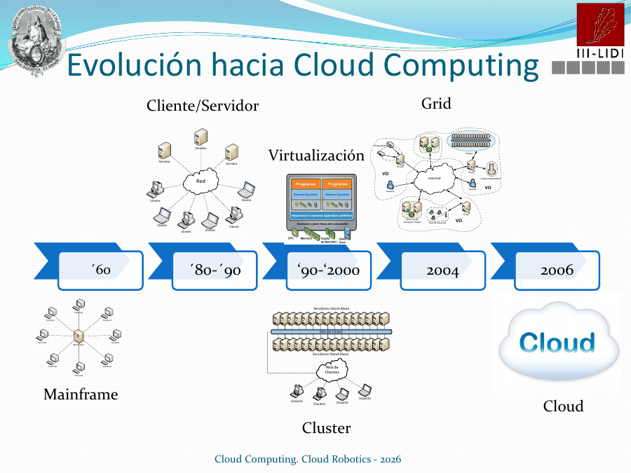
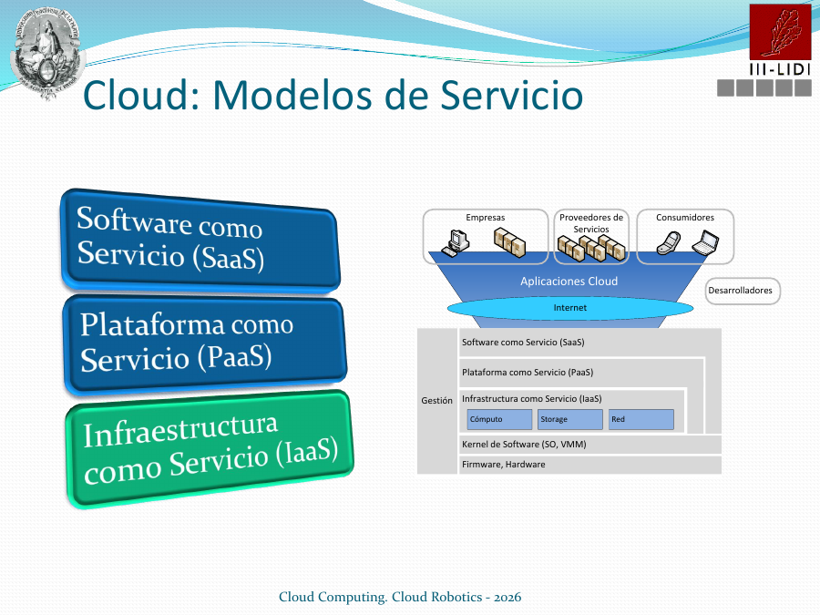
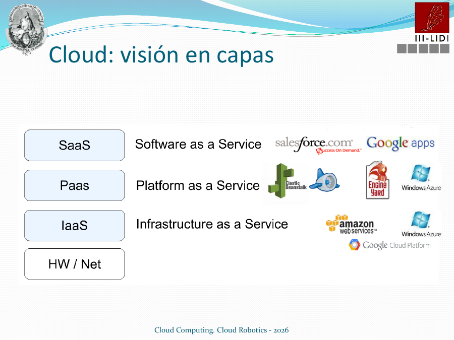
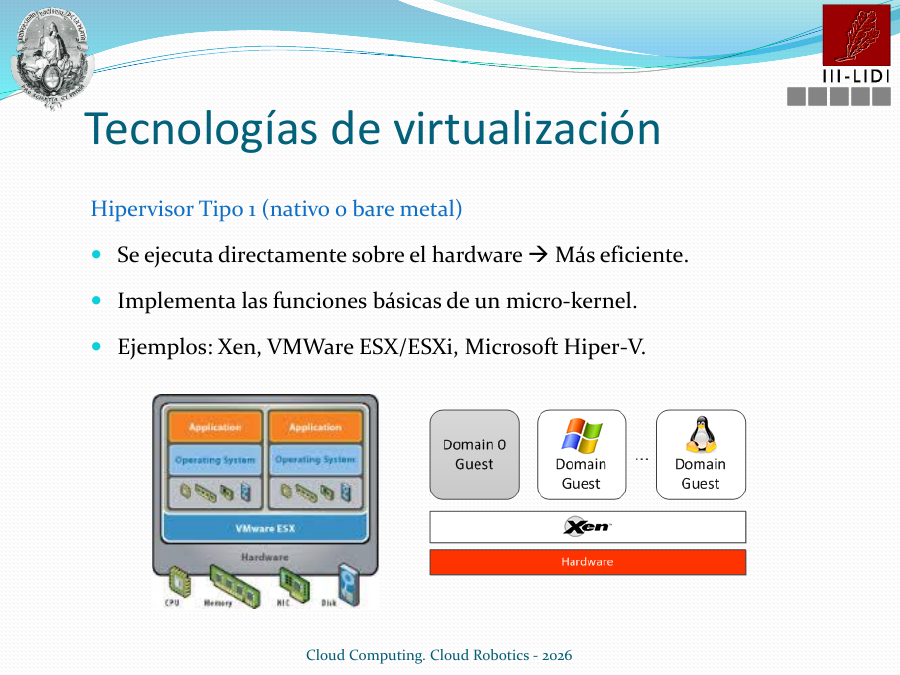
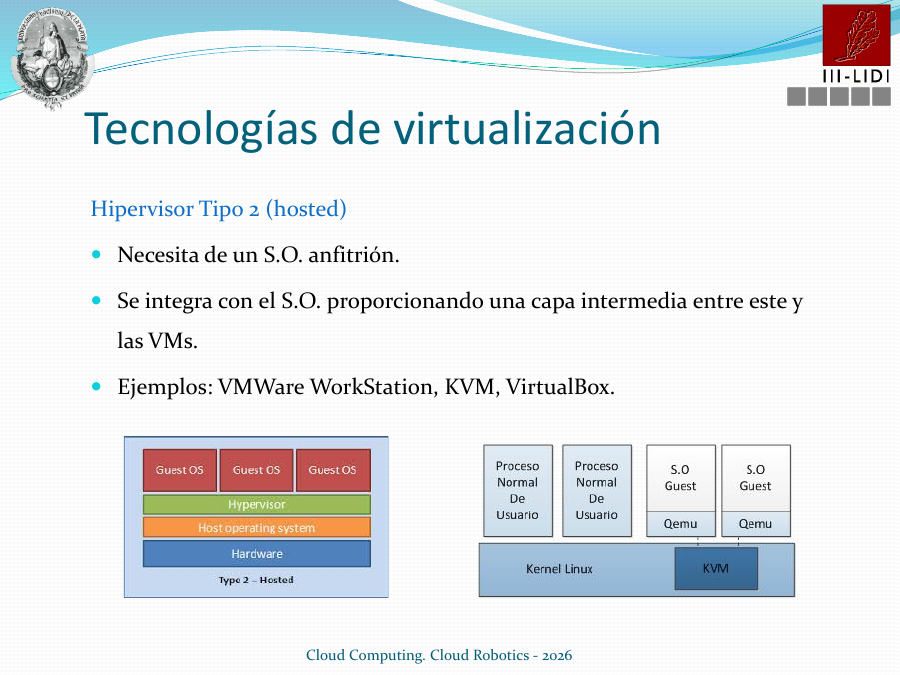
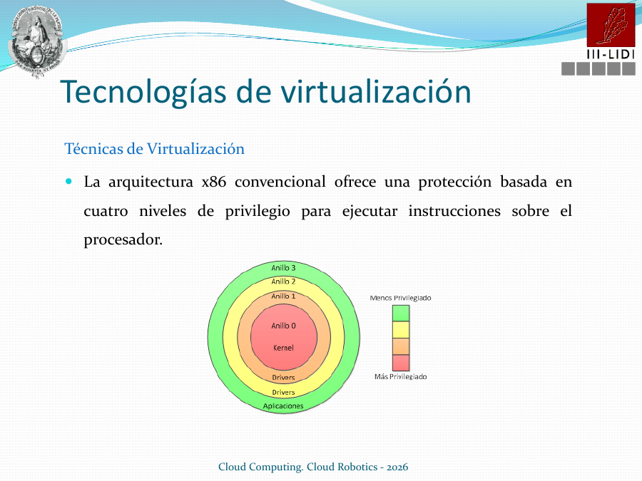

# Clase 1 – Introducción a Cloud Computing

> Teoría 1 (Lic. Ismael P. Rodríguez). Temas: qué es Cloud Computing, modelos de servicio, modelos de despliegue, beneficios y riesgos, virtualización y despliegue de un cloud privado.

---

## 1. ¿Qué es Cloud Computing?

### Evolución hacia Cloud Computing

Cloud no apareció de la nada: es el resultado de varias etapas en la forma de organizar el cómputo.

| Época | Modelo | Idea principal |
|---|---|---|
| '60 | **Mainframe** | Una computadora central enorme y muchas terminales "tontas" conectadas. |
| '80–'90 | **Cliente/Servidor** | Servidores *stand-alone* que atienden pedidos de clientes en red. |
| '90–2000 | **Cluster** | Varios servidores unidos por una red propia que trabajan como uno solo. |
| 2004 | **Grid** | Recursos de distintas organizaciones (VO, organizaciones virtuales) compartidos por Internet. |
| 2006 | **Virtualización / Cloud** | Recursos virtuales que se piden por Internet y se pagan por uso (en 2006 arranca AWS). |

### ¿Cloud Computing = Utility Computing?

La evolución hacia un **"modelo de servicio"** era inevitable gracias a dos factores que convergieron:
- La **interconexión de redes** de infraestructura (Internet rápida y confiable).
- La **maduración de las tecnologías de virtualización**.

**Analogía con la energía eléctrica:** no tenés una central eléctrica en tu casa; enchufás y pagás lo que consumís. Con cloud pasa lo mismo:
- **Aprovisionamiento:** bajo demanda.
- **Facturación:** pago por uso.

Pero **no son lo mismo**:
- **Utility Computing** es un **modelo de negocios** para proveer servicios (cobrar como un servicio público).
- **Cloud Computing** es **más que eso**: es un **paradigma** que permite presentar un modelo de servicios y desplegar arquitecturas, **no necesariamente de negocios** (por ejemplo, un cloud privado en una universidad no se cobra).

### El problema que resuelve

Ejemplo: **Mercado Libre**. ¿Cómo dimensionás los servidores si la demanda varía muchísimo?
- Demandas estacionales: *Black Friday*, Navidad, *Hot Sale*.
- Eventos masivos: Juegos Olímpicos, juegos on-line.

Si comprás servidores para el pico, el resto del año están ociosos (plata tirada). Si comprás para el promedio, en el pico se cae el sitio.

**Solución:** aprovisionamiento bajo demanda → *consumí lo que necesites, pagá lo que consumís*.

### Definición

Cloud Computing es un **nuevo paradigma de cómputo distribuido**:
- Surge como **evolución natural** de los Clusters, Grids y la Virtualización.
- Tiene su **origen en el modelo de negocios Utility Computing**.
- Proporciona:
	- **Grandes conjuntos de recursos virtuales** accesibles y utilizables a través de la Web.
	- **Recursos como servicios.**
	- **Reconfiguración dinámica** de esos recursos (**escalabilidad y elasticidad**).
	- **Acceso bajo demanda.**
- Suele explotarse comercialmente.

> El término **"nube"** hace referencia a la infraestructura física sobre la que se despliega: el usuario **no conoce la ubicación ni la organización real** de esa infraestructura (por eso se dibuja como una nube en los diagramas de red).

---

## 2. Modelos de servicio

Se piensan **en capas**: cada capa se apoya en la de abajo, y cuanto más arriba, menos cosas administra el usuario.

| Capa | Qué te dan | Qué administrás vos | Ejemplos |
|---|---|---|---|
| **SaaS** | La aplicación lista para usar | Solo tus datos y tu uso | Gmail, Google Apps, Salesforce |
| **PaaS** | Un entorno para desarrollar y desplegar | Tu código / tu aplicación | Google App Engine, Heroku, Azure App Service |
| **IaaS** | Infraestructura virtual (VMs, discos, redes) | SO, software, configuración | **Amazon EC2**, Google Compute Engine |
| HW / Red | Hardware físico, firmware, kernel (SO, VMM) | — (lo gestiona el proveedor) | — |

### IaaS – Infraestructura como Servicio
Ofrece, **por medio de la virtualización**, recursos de infraestructura virtual (servidores, almacenamiento, dispositivos de red, etc.), **flexibles y escalables**. Muchos usuarios **comparten el mismo hardware físico** de forma **transparente, segura e independiente**.
- El usuario **no controla la infraestructura subyacente** (no toca el hardware), pero sí el SO y lo que instala.
- Es lo que usamos en la materia con **AWS EC2**.

### PaaS – Plataforma como Servicio
El cloud entrega **entornos ya configurados** con las herramientas necesarias para **desarrollar y desplegar** aplicaciones, sin que el usuario instale ni administre la infraestructura.
- Soporta el **ciclo de vida completo** de una aplicación o servicio web.

### SaaS – Software como Servicio
Ofrece **aplicaciones** que se usan **sin instalarlas** localmente, generalmente desde el **navegador**.
- La instalación y el mantenimiento son responsabilidad del **proveedor**.

> **Truco para recordarlo:** cuanto más "arriba" (SaaS), menos te ocupás vos y menos control tenés; cuanto más "abajo" (IaaS), más control y más responsabilidad.

---

## 3. Modelos de despliegue

Originalmente eran **tres**: **público, privado e híbrido**. Después se sumó un cuarto: **comunidad**.

### Cloud público
Lo despliega un **proveedor de IT** y ofrece servicios (IaaS, PaaS y/o SaaS) con **acceso público desde Internet**. Contexto **comercial**: los usuarios son clientes y **pagan por tiempo de uso**.

Proveedores y créditos gratuitos mencionados en clase:
- **AWS:** U$S 200 o 6 meses de capa gratuita.
- **Google Cloud Platform:** U$S 300 o 90 días.
- **DigitalOcean:** U$S 200 o 60 días.
- **Vultr:** U$S 250 de crédito.
- **Equinix.**

- **Ventaja:** acceso **inmediato** a muchos recursos con **mínima inversión** inicial.
- **Desventajas:** **costo acumulado alto** a largo plazo y dudas sobre **privacidad y seguridad** de los datos.

### Cloud privado
Desplegado en la **intranet** de una organización (**detrás del firewall**), sobre su **propio hardware**. Ofrece servicios parecidos al público, pero **el acceso se limita a la red privada** y **no tiene carácter comercial**.
- **Ventajas:**
	- **Mayor eficiencia** en el uso del hardware: los recursos del datacenter se **consolidan mediante virtualización**.
	- **Alta seguridad** de los datos sensibles: aplican las mismas políticas y medidas de seguridad del datacenter.
- **Desventaja:** **escalabilidad limitada** a la capacidad física del datacenter. Ante grandes picos de demanda no alcanza → lo resuelve el cloud híbrido.
- **Ejemplo de plataforma:** **OpenNebula** (open source, para cloud y edge computing).

### Cloud híbrido
Un **cloud privado que usa de forma segura recursos de un cloud público**. Muy útil cuando la organización necesita **crecer rápido para atender picos de demanda**: contrata cloud público para "expandir" su cloud privado.
- A esta modalidad se la llama **"Cloud Bursting"** (el privado "desborda" hacia el público).
- Combina los beneficios de ambos: **eficiencia** del datacenter propio, **seguridad** de los datos y **disponibilidad** de recursos para grandes demandas.

### Cloud comunidad
Definición de **Gartner**: entorno **compartido por un conjunto limitado de organizaciones** (bancos, gerentes de empresas, etc.) cuyos miembros comparten **los mismos requisitos** de seguridad, privacidad, rendimiento, etc.
- Ejemplos: **Salesforce Community Cloud**, **Streamlit Community Cloud**.
- Opinión del profesor: en la práctica son **Plataformas como Servicio (PaaS)**.

---

## 4. Características, beneficios y riesgos

### Características y beneficios
- **Recursos bajo demanda:** con un cloud público no instalás ni mantenés un datacenter; pagás lo que usás. Con privado/híbrido optimizás el datacenter propio por **consolidación y virtualización** → menos consumo de energía, menos infraestructura y menos gastos.
- **Interfaces basadas en servicios Web:** se accede a los recursos de manera sencilla (consola web, APIs).
- **Escalabilidad y elasticidad:**
	- **Escalabilidad:** los recursos pueden crecer mucho.
	- **Elasticidad:** se pueden **agregar o liberar dinámicamente** según la carga de trabajo.
- **Aprovisionamiento automático:** los recursos se asignan **de forma inmediata y automática**, sin intervención de personal técnico o administrativo.
- **Autoservicio:** el usuario pide lo que necesita desde una interfaz web y tiene control directo sobre el despliegue y la configuración.

> **Escalabilidad vs. elasticidad** (pregunta típica): escalabilidad es la *capacidad* de crecer; elasticidad es crecer **y achicarse automáticamente** acompañando la demanda (y pagar solo por lo usado).

### Riesgos
- **Seguridad:** física (en los datacenters), autenticación y control de acceso, cifrado de la información confidencial en tránsito y garantías de aislamiento entre VMs.
- **Dependencia de la red:** ancho de banda limitado, rendimiento impredecible en horas pico y necesidad de estar siempre conectado.
- **Dependencia del proveedor:** fiabilidad, fallos masivos o caídas del proveedor, poca interoperabilidad y falta de estándares (*vendor lock-in*).
- **Aspectos legislativos:** legislaciones no armonizadas, responsabilidad legal poco clara (¿qué ley se aplica si hay un conflicto?) y garantías al mover datos fuera de un país o región.
- **Integridad de los datos:** perdés control sobre ellos, porque están distribuidos por la red. ¿Podés confiar en el proveedor? Además puede haber acceso a los datos sin aviso por orden judicial (ej.: **USA Patriot Act**).
- **Dificultad de implementar clouds híbridos:** cada empresa es un mundo (falta estandarización) y se necesita personal experimentado.

### El cloud público no satisface todas las necesidades
- Privacidad de los datos, normativas y ubicación geográfica de los datos.
- Migración a otros proveedores (falta de estándares).
- **SLA** (*Service Level Agreement*, acuerdo de nivel de servicio) y garantías. Ej.: **Amazon EC2 asegura al menos 99,95 %** de disponibilidad mensual.
- Redundancia y recuperación ante desastres.
- Confianza en el proveedor.

### Prepararse para lo inesperado: casos reales de fallas
- **Menéame (AWS Dublín, 2011):** un rayo provocó un incendio que inutilizó el transformador principal **y** el sistema que arrancaba el generador de respaldo. Falló EBS (los volúmenes) y, durante la restauración, se descubrió que un fallo de software había inutilizado algunos **snapshots**. Encima el administrador estaba de vacaciones sin notebook. Resultado: **2 días caído**.
	- Qué falló: energía y sus redundancias, sincronización de EBS, control desde la API, instancias bloqueadas, backups corruptos y falta de automatización para recuperar la consistencia.
- **DonWeb, nodo NOVA (Argentina):** ver el detalle en la [Clase 3](clase-3.md).
- **Región Virginia del Norte (2012):** afectó a GitHub, Reddit, Pinterest, Airbnb, Foursquare y Minecraft.
- **S3 (28/02/2017):** un **error de tipeo** de un empleado de Amazon tiró S3 y afectó a Infobae, Netflix, Spotify, Airbnb, Prime Video y Amazon Music.
- **Falla eléctrica (31/08/2019):** afectó, entre otros, al diario El Día.

> **Conclusión:** las fallas ocurren, aunque sean improbables. Hay que **diseñar pensando en redundancia** (varias zonas, varias regiones e incluso varios proveedores).

---

## 5. Tecnologías de virtualización

La virtualización **abstrae el hardware**: agrega una capa de software sobre el hardware x86 que permite **ejecutar varias máquinas virtuales (VMs) a la vez en un solo equipo físico**. Esa capa se llama **hipervisor** o **VMM** (*Virtual Machine Monitor*).

### Beneficios
- Varias VMs con **distintos sistemas operativos** en un mismo host.
- **Aislamiento** entre VMs (si una se rompe, las otras siguen).
- **Consolidación de servidores:** mejor uso de los recursos y menos costos.
- **Agregación de recursos** (*resource pooling*): facilita la escalabilidad.
- **Migración dinámica de VMs:** balanceo de carga y tolerancia a fallos.
- Facilita la administración y la automatización.

### Tipos de hipervisor

| | **Tipo 1 – nativo / bare metal** | **Tipo 2 – hosted** |
|---|---|---|
| Dónde corre | **Directamente sobre el hardware** | **Sobre un SO anfitrión** |
| Eficiencia | Más eficiente | Menos eficiente (hay un SO de por medio) |
| Cómo funciona | Implementa las funciones básicas de un micro-kernel | Se integra con el SO y hace de capa intermedia entre el SO y las VMs |
| Ejemplos | **Xen, VMware ESX/ESXi, Microsoft Hyper-V** | **VMware Workstation, VirtualBox** (y KVM según la diapositiva) |
| Uso típico | Datacenters, clouds | PC de escritorio, pruebas |

> **Ojo con KVM:** la diapositiva lo pone como tipo 2, porque se instala en un Linux "normal". Pero KVM es un **módulo del kernel de Linux** que convierte al propio kernel en hipervisor, y por eso muchos autores (y la documentación de AWS y Red Hat) lo clasifican como **tipo 1**. Para el examen conviene responder lo de la cátedra y, si da el espacio, aclarar esta discusión.

### Anillos de privilegio (por qué la virtualización es difícil en x86)

La arquitectura x86 tiene **4 niveles de privilegio** (anillos 0 a 3):
- **Anillo 0:** el más privilegiado (**kernel** del SO).
- **Anillos 1 y 2:** drivers.
- **Anillo 3:** el menos privilegiado (**aplicaciones**).

Sin virtualización, cuando una aplicación (anillo 3) quiere ejecutar una instrucción privilegiada (acceder a memoria o a E/S), la petición se **captura**, se **eleva el privilegio** para que el SO la ejecute y después se devuelve el control al anillo 3.

Con virtualización, lo deseable es que:
- El **VMM corra en el anillo 0** (controla las VMs y el hardware).
- El **SO guest corra en un anillo menos privilegiado**. Cuando intenta ejecutar algo privilegiado, el **VMM lo captura y lo emula**.

El problema es que los SO guest "creen" que están en el anillo 0. Las técnicas de virtualización de CPU resuelven ese conflicto de distintas maneras:

### Técnicas de virtualización

| Técnica | Cómo funciona | ¿Hay que modificar el SO guest? | Rendimiento | Ejemplos |
|---|---|---|---|---|
| **Virtualización completa** (*full*) | Abstracción **completa** del hardware: el VMM captura y emula las instrucciones privilegiadas | **No** | Algo más pobre | VMware Workstation, QEMU, KVM, VirtualBox |
| **Paravirtualización** | El SO guest se **modifica** para que "sepa" que está virtualizado y le pida las cosas al hipervisor directamente | **Sí** (menor portabilidad: ej. Windows no se puede modificar) | Bueno | Xen PV |
| **Asistida por hardware** (**HVM**) | Usa extensiones del procesador: **Intel VT-x, AMD-V, VT-i** | **No** (pero necesita **CPU con soporte** de virtualización) | Bueno | Xen 3.x, KVM, VMware Workstation |

> La virtualización completa da **mejor aislamiento y seguridad**. La HVM **combina lo mejor de las dos anteriores**: no modifica el SO y tiene buen rendimiento.

---

## 6. Despliegue de un cloud privado

- Es para **uso exclusivo de una organización** con muchos usuarios (ej.: el centro de cómputo de una universidad).
- Puede ser **propio** (*on-premise*), **alquilado** (*hosted*) o una combinación.
- Permite una **gestión flexible y ágil** de los recursos de la organización.
- En clase se mostró la instalación con **OpenNebula**: un **front-end**, que gestiona y orquesta, y **nodos**, que son los hosts con el hipervisor donde corren las VMs.

---

## Preguntas para repasar
1. ¿Por qué Cloud Computing no es lo mismo que Utility Computing?
2. ¿Qué problema resuelve el aprovisionamiento bajo demanda? Da un ejemplo.
3. Compará IaaS, PaaS y SaaS: qué administra el usuario en cada uno y un ejemplo de cada uno.
4. ¿Qué es *cloud bursting* y en qué modelo de despliegue aparece?
5. Ventajas y desventajas del cloud público frente al privado.
6. Diferencia entre escalabilidad y elasticidad.
7. Hipervisor tipo 1 vs. tipo 2 (con ejemplos).
8. ¿Por qué los anillos de privilegio de x86 complican la virtualización? ¿Cómo lo resuelve cada técnica?
