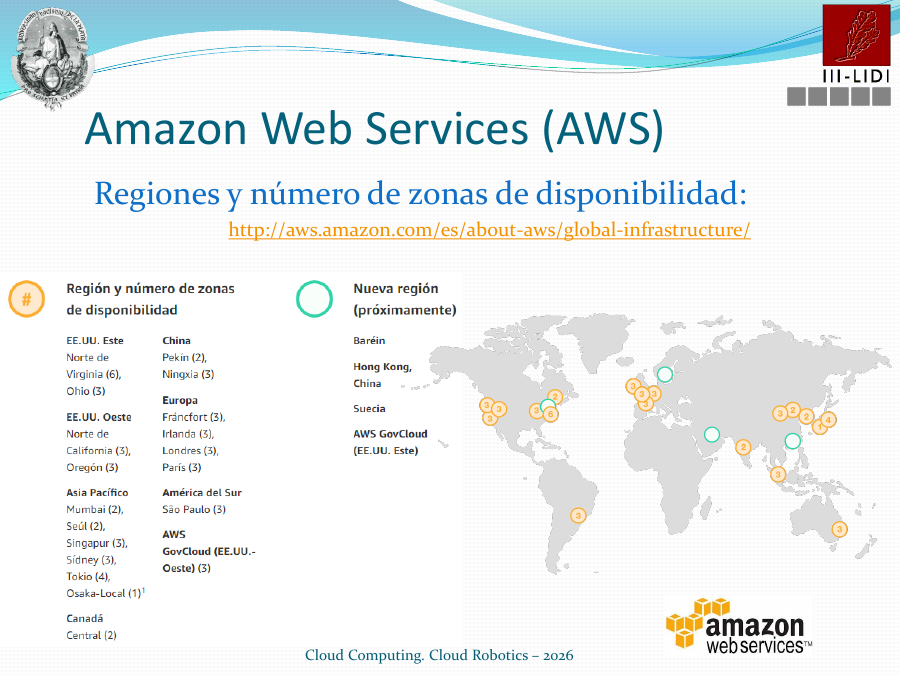
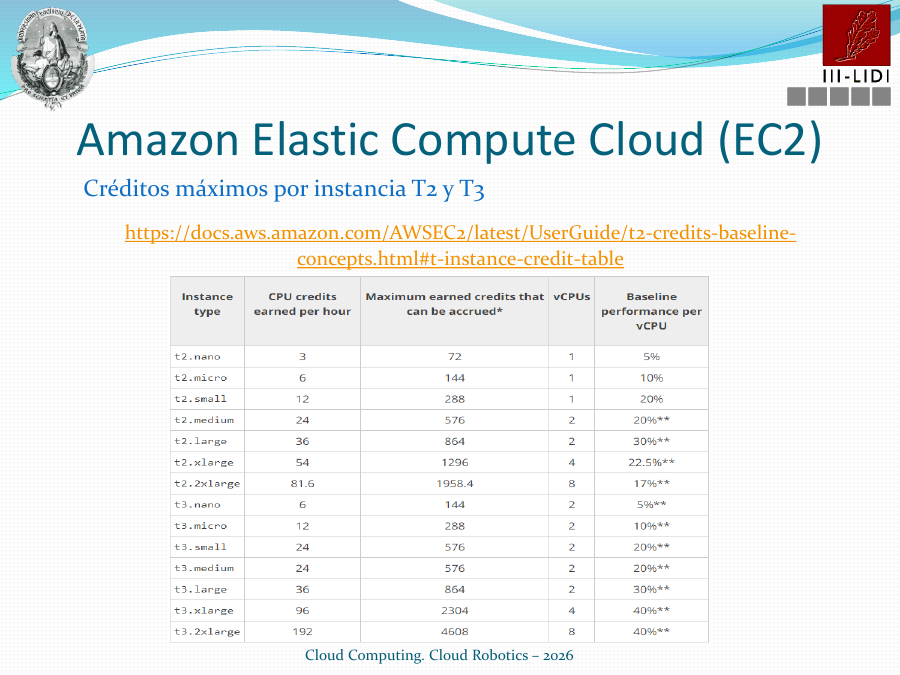
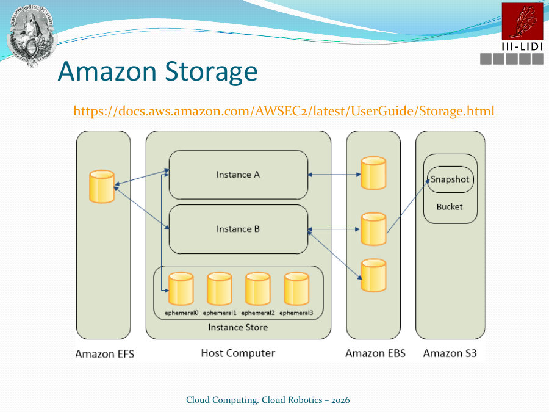
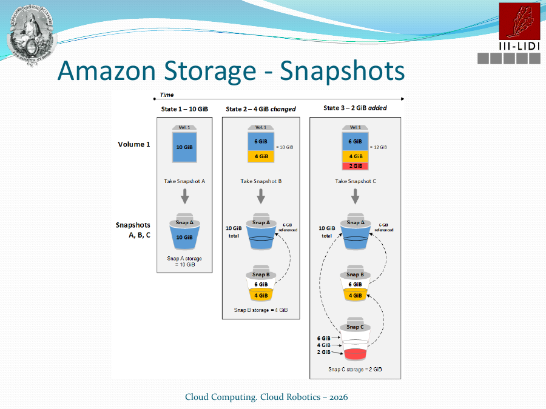
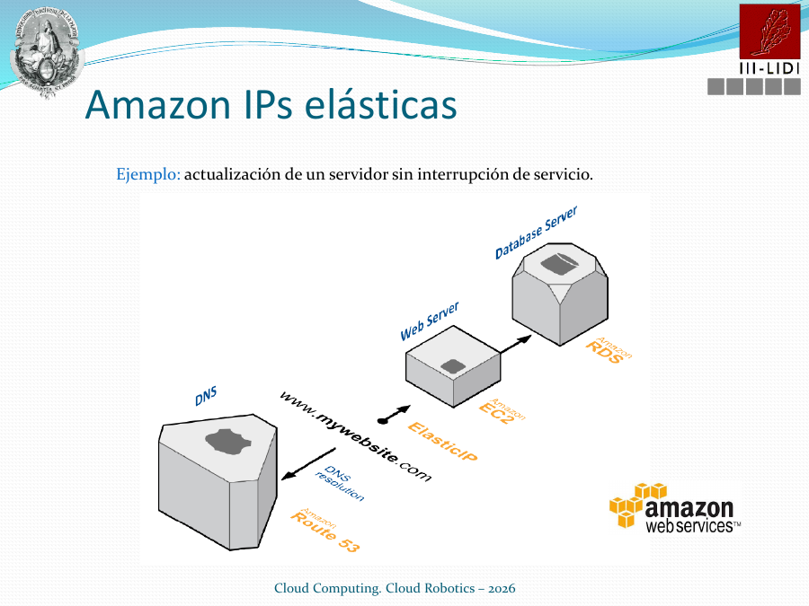
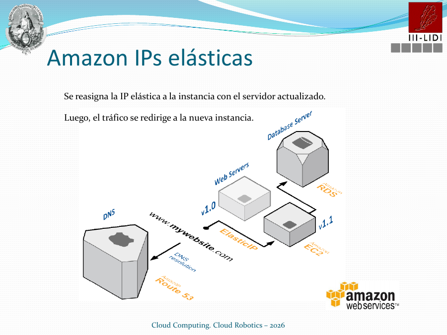

# Clase 2 – Amazon Web Services (AWS) y EC2

> Teoría 2. Temas: AWS, Amazon EC2, almacenamiento (EBS, S3, EFS, snapshots), CloudWatch e IPs elásticas.

---

## Amazon Web Services (AWS)

- AWS empezó en **2006** a ofrecer servicios de cloud a empresas. Hoy tiene **más de 240 servicios**: Big Data, aplicaciones móviles, alojamiento web, arquitecturas tolerantes a fallos, streaming, etc.
- **El núcleo (core) de Amazon es EC2.** En Amazon no se habla de "máquina virtual" sino de **instancia**, aunque por detrás es una máquina virtual.
- **Amazon CloudWatch** es el sistema de **monitoreo**. Junto con **Auto Scaling** es lo que permite manejar la **elasticidad** (agregar o quitar instancias según la carga).

Los servicios se agrupan en categorías:
- Procesamiento de datos (cómputo).
- Almacenamiento.
- Bases de datos.
- Entrega de contenidos.
- Mensajería.
- Red.
- Otros.

Amazon ofrece un **nivel de seguridad muy alto**.

### Regiones y zonas de disponibilidad

- **Región:** zona geográfica (ej.: *EE. UU. Este – Ohio*, que es la que usamos por defecto en la materia).
- **Zona de disponibilidad (AZ, *Availability Zone*):** uno o más **datacenters independientes** dentro de una región, con su propia energía y su propia red.

**Alta disponibilidad a través de varias zonas:** cada región tiene **varias zonas de disponibilidad y varios centros de datos**. Quien quiera disponibilidad y rendimiento implementa su aplicación en **varias zonas de la misma región**, para lograr **tolerancia a fallos y baja latencia**. (La latencia se mide, por ejemplo, con un `ping`, que usa el protocolo **ICMP**). Las zonas están conectadas entre sí por **fibra óptica rápida y privada**, así que una aplicación puede **conmutar por error** (*failover*) de una zona a otra **sin interrupciones**.



> Los servicios disponibles **no son los mismos en todas las regiones**. Antes de elegir una región, hay que revisar que tenga lo que necesitás.

### Plan gratuito (capa gratuita)

> **Corrección:** según la diapositiva, desde el **15/07/2025** el nivel gratuito da **hasta U$S 200 de crédito**: se asignan **U$S 100 al inicio** y el resto (**otros U$S 100**) se puede pedir después, durante **6 meses**. Al pasar a un plan pago, los créditos del nivel gratuito se mantienen por 12 meses. Al registrarte te piden una tarjeta de crédito, pero mientras haya crédito el consumo se descuenta de ahí y no de la tarjeta.

Incluye, entre otras cosas:
- Instancias EC2 sin costo: **t3.micro**, t3.small, t4g.micro, t4g.small, c7i-flex.large, m7i-flex.large (Linux y/o Windows).
- **5 GB de S3** estándar, **30 GB de EBS** (SSD o magnético).
- 25 GB en DynamoDB; 750 h de RDS db.t2.micro y 20 GB de almacenamiento RDS.
- **10 métricas y 10 alarmas** en CloudWatch.
- **250.000 mensajes en AWS IoT.**

---

## Amazon EC2 (Elastic Compute Cloud)

- Permite ejecutar **varias instancias ("servidores virtuales") Linux o Windows bajo demanda**: adquirís tantos equipos como necesite tu aplicación.
- Da **acceso "root" o de administrador** al SO de cada instancia, un **firewall** (los **grupos de seguridad**) para controlar el acceso por red y libertad para instalar cualquier software.
- Una vez configurada la instancia, se puede **guardar esa configuración como una AMI** (*Amazon Machine Image*) y lanzar muchas VMs iguales bajo demanda.
- La **EC2 API** (Query o SOAP) permite iniciar y detener instancias, configurar permisos de acceso y red, y gestionar imágenes. Cada servidor se administra con herramientas de Linux o Windows sobre una **sesión de shell segura** (SSH).
- **Se factura según los recursos consumidos**: CPU (tiempo de instancia encendida) y transferencia de datos.

### AMI (Amazon Machine Image)
Una instancia **se crea a partir de una imagen** con un **sistema operativo preconfigurado** (y a veces software instalado). La idea es tener una máquina corriendo el SO que elijas y poder usarla junto con los servicios propios de Amazon.
- Hay AMIs **gratuitas y pagas**; cualquier usuario puede **publicar las suyas** (en el **AWS Marketplace**).
- En la materia usamos la AMI **Debian 13** (apta para la capa gratuita).

### Tipos de instancias
EC2 ofrece muchos **tipos de instancia** optimizados para distintos casos de uso. **Los tipos combinan distintas cantidades de CPU, memoria, almacenamiento y red.** Cada tipo tiene **uno o varios tamaños** (nano, micro, small, medium, large…), para escalar según la carga.

> **Cómo leer el nombre:** en `t3.micro`, la **t** es la familia (uso general con ráfagas), el **3** es la generación y **micro** es el tamaño.

#### Instancias de "uso / propósito general" T2 y T3: desempeño con ráfagas
Las T2 y T3 son [instancias de desempeño con ráfagas](https://aws.amazon.com/es/ec2/instance-types/#burst): dan un **nivel base de CPU** y pueden hacer **ráfagas por encima** de ese nivel cuando hace falta.

**Características de la T2:**
- Procesadores **Intel Xeon** de alta frecuencia, con Turbo de hasta 3,3 GHz.
- **CPU en ráfagas**, regida por **créditos de CPU** y un rendimiento base constante.
- Uso general a bajo costo; en la capa gratuita, **solo t2.micro**.
- Equilibrio entre cómputo, memoria y red.
- Buena opción para cargas que **no usan la CPU a pleno de forma constante** pero a veces necesitan picos: **servidores web, entornos de desarrollo y bases de datos pequeñas**.

#### Cómo funcionan los créditos de CPU
- **1 crédito de CPU = 1 vCPU al 100 % durante 1 minuto.**
- La instancia **gana créditos constantemente** (más o menos según su tamaño), los **acumula cuando está ociosa** y los **gasta cuando hace ráfagas**.
- **Ejemplo t2.small:** recibe **12 créditos por hora**, lo que equivale a un desempeño base del **20 %** de un núcleo (20 % × 60 min = 12 min). Si no los usa, los acumula hasta un **máximo de 288**. Si necesita más del 20 %, gasta del saldo.



#### Modo *standard* vs. modo *unlimited*
- **T2 arranca en modo "standard"** por defecto: cuando se le acaban los créditos, queda limitada al rendimiento base.
- **T3 arranca en modo "unlimited"** por defecto: puede seguir haciendo ráfagas aun con el saldo en cero.
- En modo unlimited, si el **uso promedio de CPU en 24 h** es **menor o igual al base**, el precio por hora ya cubre todo. Si lo **supera** de forma sostenida, se paga un cargo extra de **U$S 0,05 por hora de vCPU** (Linux).
	- Ejemplo: una t2.small unlimited que promedia **25 %** (5 % por encima de su base del 20 %) durante 24 h, con el saldo en cero, paga ese adicional.
- Por región se pueden lanzar hasta **20 instancias T2 y 20 T3** simultáneas.

#### Otros tipos vistos
- **M4 – bases de datos pequeñas y medianas:** Intel Xeon E5 (Broadwell/Haswell), **optimizadas para EBS** sin costo adicional y con redes mejoradas. Van de m4.large (2 vCPU, 8 GiB) a m4.10xlarge (40 vCPU, 160 GiB), con almacenamiento solo EBS.
- **M5 – última generación:** Intel Xeon Platinum de 2,5 GHz, almacenamiento SSD **NVMe** y hasta **25 Gbps** de red.

### Características del servicio EC2
- **Elástico:** aumenta o disminuye la capacidad **en minutos**.
- **Control total:** acceso root a las VMs (detener, reiniciar, terminar).
- **Flexible:** muchos tipos de instancia, SO y software; elegís memoria, CPU, almacenamiento, etc.
- **Fiable:** compromiso de disponibilidad (SLA) del **99,95 %** en cada región.
- **Seguro:** firewall (grupos de seguridad), aislamiento con **VPC** (*Virtual Private Cloud*) y acceso por **VPN IPsec**.
- **Económico:** tarifas accesibles; pagás lo que usás.

---

## Amazon Storage (EBS, S3, EFS…)

| Servicio | Tipo | Analogía | Cómo se accede |
|---|---|---|---|
| **EBS** (*Elastic Block Store*) | Almacenamiento **en bloques** (volúmenes) | Un **disco rígido** enchufado a la instancia | Se monta como dispositivo en **una** instancia (misma AZ) |
| **S3** (*Simple Storage Service*) | Almacenamiento **de objetos** | Un "Drive" de archivos con URL | Por **URL / API / consola web** |
| **EFS** (*Elastic File System*) | Almacenamiento **de archivos** (NFS) | Una **carpeta compartida en red** | Se monta por **NFS** desde **varias** instancias a la vez |
| *Instance store* (efímero) | Disco físico del host | Disco "temporal" | Se pierde al detener la instancia |



> **Corrección sobre precios:** en clase quedó anotado que EBS "es el más caro de todos". **S3 sí es el más económico** por GB, pero el más caro por GB suele ser **EFS** (aprox. U$S 0,30 por GB/mes, contra U$S 0,08 de EBS gp3 y U$S 0,023 de S3 estándar). Lo que sí pasa con EBS es que **pagás todo el volumen que reservás**, lo uses o no; en S3 y EFS pagás solo lo que ocupás.

### EBS (Elastic Block Store)
Servicio de almacenamiento **basado en volúmenes**.
- Es como usar un **disco rígido sin formatear**: la instancia lo ve como un dispositivo y le pone su propio sistema de archivos.
- Está diseñado para usarse con instancias EC2:
	- Los volúmenes **se montan como dispositivos** y se accede a ellos **a través de la red**.
	- **Persisten con independencia de las instancias**: si apagás o terminás la instancia, el volumen puede seguir existiendo (salvo el volumen *root*, que por defecto se borra al terminar).
	- Una instancia puede montar **varios volúmenes**, siempre **en la misma zona de disponibilidad**.
- **Características:**
	- Tamaños de **4 GB a 16 TB** (según la diapositiva).
	- **Replicación dentro de la misma zona** de disponibilidad.
	- **Instantáneas (snapshots) en S3.**
- **Tipos de volumen:**
	- **SSD de uso general (gp2):** hasta **3.000 IOPS**.
	- **SSD con IOPS aprovisionadas (io1):** hasta **32.000 IOPS** y **500 MB/s**, para bases de datos exigentes.
	- **Magnético / HDD (st1 o sc1):** hasta **250 MB/s** de *throughput*; barato, para datos secuenciales.

> **IOPS** = operaciones de entrada/salida por segundo (importan para accesos aleatorios, como en las bases de datos). **Throughput** = MB/s transferidos (importa para lecturas grandes y secuenciales).

### Snapshots (backups)
Los **backups** de los volúmenes EBS se llaman **snapshots** y **se guardan en S3** (para S3 son un objeto más).
- Son **incrementales**: el primero copia todo y los siguientes **solo guardan los bloques que cambiaron**.
- **Se replican entre varias zonas de disponibilidad.**
- Permiten **recuperar el volumen** ante una falla o crear volúmenes nuevos a partir de ellos.



**Ejemplo de la diapositiva:**
1. Volumen de 10 GiB → **Snap A** guarda **10 GiB**.
2. Cambian 4 GiB → **Snap B** guarda solo esos **4 GiB** (el resto lo referencia de A).
3. Se agregan 2 GiB → **Snap C** guarda solo esos **2 GiB**.

A medida que vas haciendo snapshots, **vas ocupando (y pagando) más espacio en S3**.

### S3 (Simple Storage Service)
**Almacenamiento de objetos** (archivos y carpetas) a escala web.
- Los objetos se guardan en **depósitos (*buckets*)**.
- **Cada objeto tiene una URL única.**
- Tamaño de **1 byte a 5 TB** por objeto; **cantidad de objetos ilimitada**.
- Es el **más económico** y tiene **interfaz web**.
- **Características:**
	- Redundancia en varios dispositivos de **distintos datacenters**.
	- **Durabilidad: 99,999999999 %** (los famosos "11 nueves": es casi imposible que se pierda un objeto).
	- **Disponibilidad: 99,99 %** en un año.
	- Permite **lectura y escritura concurrentes**.
	- Los cambios **tardan un poco en propagarse** entre las réplicas.
	- Los objetos **no salen de la región** salvo que los transfieras a mano.
- **Usos con EC2:** guardar **AMIs y snapshots** y alojar **sitios web estáticos**.

> **Durabilidad ≠ disponibilidad.** Durabilidad es que el dato **no se pierda**; disponibilidad es que puedas **acceder** a él en un momento dado.

### EFS (Elastic File System)
- Es un **sistema de archivos en red (NFS)** que se tiene que crear en la **misma VPC** que la instancia donde se va a montar.
- Al lanzar la instancia, se configura un script (*user data*) que monta el volumen:

```bash
#!/bin/bash
yum update -y
yum install -y nfs-utils                     # cliente NFS
FILE_SYSTEM_ID=fs-xxxxxxxx                   # ID del EFS creado
AVAILABILITY_ZONE=$(curl -s http://169.254.169.254/latest/meta-data/placement/availability-zone )  # AZ de la instancia (servicio de metadatos)
REGION=${AVAILABILITY_ZONE:0:-1}             # región = AZ sin la última letra (us-east-2a -> us-east-2)
MOUNT_POINT=/mnt/efs
mkdir -p ${MOUNT_POINT}
chown ec2-user:ec2-user ${MOUNT_POINT}
echo ${FILE_SYSTEM_ID}.efs.${REGION}.amazonaws.com:/ ${MOUNT_POINT} nfs4 nfsvers=4.1,rsize=1048576,wsize=1048576,hard,timeo=600,retrans=2,_netdev 0 0 >> /etc/fstab   # montaje permanente
mount -a -t nfs4                             # monta ahora
```

- La instancia ya tiene su propio disco y su file system; **EFS es otro file system al que accede por la red**. Ese recurso tiene un **nombre DNS fijo** (`fs-xxxx.efs.region.amazonaws.com`) y se monta como una carpeta más (`/mnt/efs`).
- Después se verifica desde la consola de la instancia (por ejemplo, con `df -h`) que el file system quedó montado.
- Ventaja: **varias instancias pueden montar el mismo EFS a la vez** (cosa que con EBS normalmente no se puede) y crece solo.

> La diapositiva usa `yum` y `ec2-user` porque el ejemplo es para **Amazon Linux**. En **Debian** sería `apt install nfs-common` y el usuario `admin`.

---

## Amazon CloudWatch
Servicio de **monitoreo de los recursos de AWS y de las aplicaciones**.
- **Recopila y grafica métricas** de distintos servicios: EC2, EBS, ELB (balanceador de carga), RDS (bases de datos), aplicaciones del usuario, etc.
- Permite **definir alarmas y ejecutar acciones automáticas**.
- Sus cuatro funciones:
	- **Recopilación:** registros (*logs*) y métricas.
	- **Monitoreo:** vista operativa unificada y alarmas.
	- **Acción:** **Auto Scaling** y respuestas automáticas.
	- **Análisis:** estadísticas históricas de hasta **15 meses** y análisis en tiempo real.
- **Ejemplo de elasticidad:** una alarma que dice "si la CPU promedio supera el 70 %" dispara Auto Scaling, que **agrega instancias**; cuando baja la carga, las **quita**.
- Capa gratuita: **10 métricas y 10 alarmas**.

**Estados de una instancia y costos:** una instancia puede estar *running*, *stopped* o *terminated*, entre otros estados.
- **Running:** pagás el cómputo.
- **Stopped:** **no pagás el cómputo**, y la configuración y los datos del EBS se conservan. Pero **seguís pagando el almacenamiento EBS** (y las IPs elásticas reservadas).
- **Terminated:** la instancia se elimina (y, por defecto, también su volumen root).

---

## IPs elásticas
- Son **direcciones IP públicas fijas asociadas a la cuenta** de usuario, **no a una instancia** en particular.
- **Se pueden reasignar dinámicamente** de una instancia a otra.
- Se resuelven:
	- **Desde afuera de AWS** → a la **IP pública** de la instancia.
	- **Desde adentro de AWS** → a la **IP privada** de la instancia.
- **Mecanismo de tolerancia a fallos:** si una instancia falla, su IP elástica se asigna a otra y **el servicio no se interrumpe** (los clientes siguen usando la misma IP).
- Por defecto hay un **límite de 5 por región**, porque las direcciones IPv4 son escasas.
- Se llaman **elásticas** porque **las podés "pegar" a cualquier instancia**, y la IP no cambia con el tiempo.

> **Corrección:** la diapositiva dice "si la instancia se detiene o se termina, la IP elástica se libera". En la práctica (y según la documentación de AWS):
> - Si la instancia **se detiene**, la IP elástica **sigue asociada**. Justamente para eso sirve: una instancia **sin** IP elástica **cambia su IP pública** cada vez que se detiene y se vuelve a iniciar.
> - Si la instancia **se termina**, la IP elástica **se desasocia**, pero **sigue reservada en tu cuenta** (y se sigue cobrando) hasta que la **liberes** a mano (*Release*).
>
> Esto se comprueba en la Actividad 1 (ver [Clase 4](clase-4.md)).

**Ejemplo: actualizar un servidor sin cortar el servicio**
1. El DNS (`www.mywebsite.com`) apunta a la IP elástica, que está asociada al servidor web v1.0.
2. Lanzás una instancia nueva con el servidor actualizado (v1.1).
3. **Reasignás la IP elástica** a la instancia nueva → el tráfico pasa a la v1.1 sin tocar el DNS.




> **Costos:** desde 2024, AWS cobra **todas las IPv4 públicas**, incluidas las elásticas, tanto si están en uso como si están reservadas y sin usar. Por eso hay que **liberarlas** cuando ya no se necesitan.

---

## Preguntas para repasar
1. ¿Qué diferencia hay entre una región y una zona de disponibilidad? ¿Para qué conviene usar varias zonas?
2. ¿Qué es una AMI y para qué sirve?
3. Explicá los créditos de CPU de las instancias T2/T3 con el ejemplo de la t2.small. ¿Qué cambia entre el modo standard y el unlimited?
4. Compará EBS, S3 y EFS (tipo de almacenamiento, acceso y uso típico).
5. ¿Por qué los snapshots son incrementales y dónde se guardan?
6. ¿Qué diferencia hay entre durabilidad y disponibilidad en S3?
7. ¿Qué funciones cumple CloudWatch? ¿Cómo se relaciona con la elasticidad?
8. ¿Qué es una IP elástica? ¿Qué pasa con ella al detener y al terminar la instancia?
