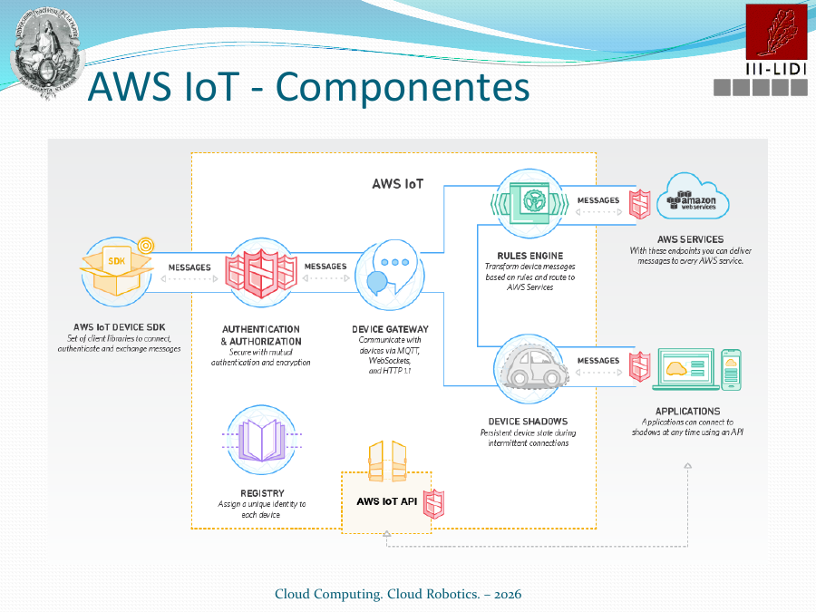
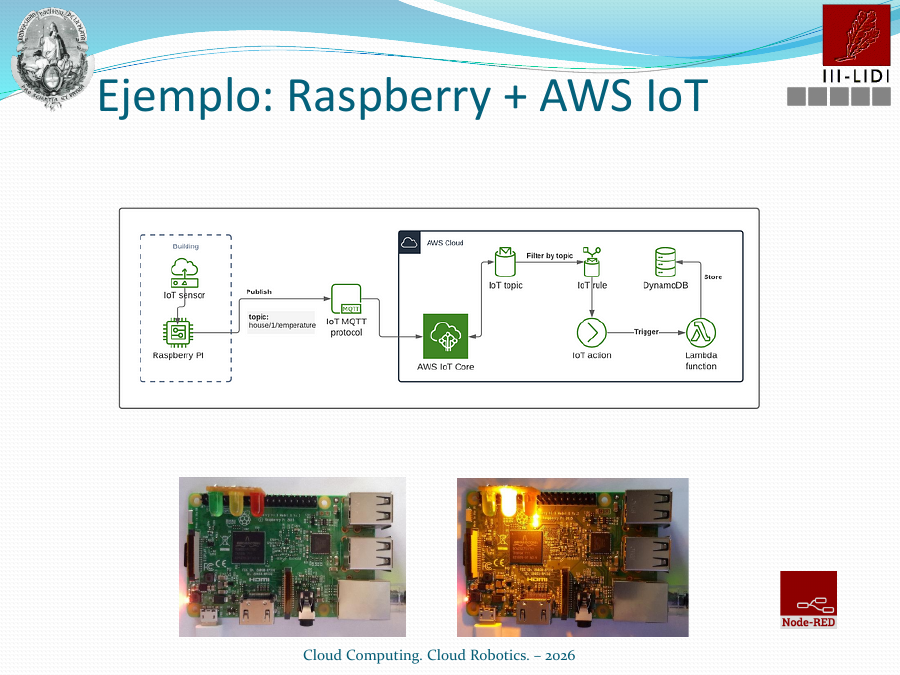

# Clase 5 – Internet de las Cosas (IoT), MQTT, AWS IoT y Node-RED

> Teoría 3 + Taller 2 (Node-RED con Docker Compose en EC2). Temas: IoT, tecnologías de comunicación, protocolo MQTT, AWS IoT, Node-RED y laboratorio.

---

## ¿Qué es Internet de las Cosas?

### ¿IoT = M2M?
- **M2M (*Machine to Machine*):** comunicación **punto a punto** entre una máquina o dispositivo y otra máquina o dispositivo **remoto**. Se hace por medio de **redes telefónicas tradicionales o móviles**. Ej.: un cajero automático que se comunica con el banco por una línea dedicada.
- **IoT:** es **mucho más que M2M**. La comunicación se hace por **redes basadas en IP**, y los datos se **envían a Internet o a la nube**, donde se procesan, se guardan y se combinan con otros servicios.

**Definición:** IoT es la **interconexión digital de objetos cotidianos por medio de Internet**. También se la define como el **momento en que se conectan a Internet más "cosas" que personas**. Si los objetos tuvieran etiquetas de radio incorporadas, otros equipos podrían identificarlos y gestionarlos igual que lo haría una persona.

> No alcanza con que un objeto esté conectado a Internet (eso es solo un *objeto conectado*). En IoT, los objetos **capturan datos de manera autónoma, intercambian eventos y son interoperables** para formar un **ambiente inteligente**.

- **Definición formal:** modelo o paradigma de **interconexión de sensores y actuadores (objetos inteligentes)** para lograr un **ambiente inteligente**, con un alto grado de **captura autónoma de datos, transferencia de eventos e interoperabilidad**.
- **Definición informal:** red de objetos "inteligentes" que usan tecnologías para **comunicarse entre ellos y con su entorno**.

### Sensores y actuadores
Los dispositivos ("cosas") cumplen uno de dos roles:

| | **Sensor** | **Actuador** |
|---|---|---|
| Qué hace | **Detecta** estímulos del medio (lee) | **Actúa** sobre el medio (escribe) |
| Conversión | Magnitud **física o química → eléctrica** | Energía **eléctrica → acción** (movimiento, luz, sonido…) |
| Ejemplos | Temperatura, humedad, movimiento (PIR), distancia (ultrasonido), luz | LED, buzzer, motor, relé, bomba, ventilador |

> **Ejemplo:** una **alarma residencial** es un **sistema** que combina los dos: los **sensores** (de movimiento o de apertura de puertas) **adquieren información**, y el **actuador** (la sirena) **ejecuta la acción** en el medio. Recordalo como **sensor = entrada** y **actuador = salida**.

---

## Tecnologías de comunicación

| Tecnología | Qué es | Alcance / velocidad | Uso típico |
|---|---|---|---|
| **NFC** (*Near Field Communication*) | Inalámbrica de **corto alcance** y alta frecuencia | **Máx. 20 cm**, hasta **424 kbit/s** | Pagos con tarjeta o celular, identificación y validación instantánea |
| **RFID** (*Radio Frequency IDentification*) | Guarda y recupera datos a distancia con **etiquetas o tags** | Variable (de cm a metros) | **Transmitir la identidad** de un objeto (como un número de serie) por radio. Es una tecnología **Auto ID** (identificación automática) |
| **Bluetooth 4.0** | Estándar para **redes de área personal (WPAN)** | Banda **ISM de 2,4 GHz** | Comunicar equipos móviles, eliminar cables, armar pequeñas redes y sincronizar datos |
| **WiFi** | Red local inalámbrica IP | Decenas de metros | Ej.: el módulo **ESP8266** le agrega WiFi a un Arduino |

> **NFC es un caso particular de RFID** de muy corto alcance, pensado para que la comunicación sea intencional (acercar la tarjeta).

---

## Protocolo MQTT

**MQTT (*Message Queuing Telemetry Transport*)** es un protocolo de conectividad para **M2M e IoT** de tipo **publicación/suscripción (*publish/subscribe*)**. Es **ligero**: está diseñado para **minimizar el ancho de banda y los recursos** que necesita, ideal para dispositivos chicos y redes inestables.

### Cómo funciona: el **broker** y los **tópicos**
- El **broker** es el "**director de tráfico**": recibe todos los mensajes y los reparte.
- Los **publicadores** (*publishers*) envían mensajes a un **tópico**. Ej.: un sensor publica `24.5` en `sensor/temperatura/sala1`.
- Los **suscriptores** (*subscribers*) se suscriben a los tópicos que les interesan y el broker les **reenvía** los mensajes.
- **Publicadores y suscriptores no se conocen entre sí:** solo conocen al broker. Esto **desacopla** los dispositivos (podés agregar o sacar uno sin tocar los demás).
- Los tópicos son **jerárquicos** (separados por `/`) y admiten **comodines**:
	- `+` = un nivel. Ej.: `sensor/+/sala1`.
	- `#` = todos los niveles de ahí para abajo. Ej.: `sensor/#`.

```
 [Sensor temp] --publish "sensor/temperatura/sala1"--> [ BROKER ] --> [Node-RED suscripto a sensor/#]
                                                                   --> [App celular suscripta a sensor/temperatura/+]
```

> **Seguridad:** MQTT **ofrece** comunicación segura **usando TLS** (en general por el **puerto 8883**), pero en sí mismo **no cifra**. El MQTT "plano" va por el **puerto 1883 sin cifrar**. AWS IoT **exige** TLS; un Mosquitto o SimuPi local en el 1883, no.

### Calidad de servicio (QoS)

| Nivel | Garantía | Riesgo | Cuándo usarlo |
|---|---|---|---|
| **QoS 0** | **"A lo sumo una vez"** (*at most once*): se entrega con el mejor esfuerzo de la red IP | Se pueden **perder** mensajes | Sensores ambientales: si se pierde una lectura, enseguida llega la siguiente |
| **QoS 1** | **"Al menos una vez"** (*at least once*): se asegura que lleguen | Puede haber **duplicados** | La mayoría de los casos, cuando no importa recibir algo repetido |
| **QoS 2** | **"Exactamente una vez"** (*exactly once*) | Más lento (más intercambio de mensajes) | **Facturación**: un duplicado o una pérdida generaría cargos incorrectos |

> **AWS IoT usa MQTT v3.1.1 y solo soporta QoS 0 y QoS 1** (no QoS 2).

### Estándar abierto y brokers
- Desde el **29/10/2014** es un **estándar abierto OASIS**. Esto es muy importante: un dispositivo configurado con MQTT funciona **con cualquier broker**, ya sea de un cloud público o privado (no te ata a un proveedor).
- Brokers:
	- **HiveMQ** (comercial).
	- **CloudMQTT** (comercial).
	- **Mosquitto** (*open source*): proyecto muy bien desarrollado, ideal para **desarrollar localmente** y después pasar a la nube pública.

---

## AWS IoT

Es una **plataforma para interconectar dispositivos de forma fácil y segura**, intercambiar datos y **procesarlos con aplicaciones en la nube**.
- Funciona como **SaaS o PaaS**, según el uso que le des.
- Amazon da un **SDK / librería (API)** para conectar los dispositivos y desarrollar.



### Componentes
1. **Broker de mensajes:** comunicación por **MQTT, HTTP o WebSockets**.
2. **Gateway para dispositivos:** permite el intercambio de mensajes con el modelo **publicación/suscripción** sobre un **tópico** concreto.
3. **Autenticación y autorización:** **autenticación mutua y cifrado** en todos los puntos de conexión. Puede ser la de AWS (**SigV4**) o con **certificados X.509**.
4. **Registro de dispositivos (*Registry*):** le da una **identidad única** a cada dispositivo ("*thing*") y define cómo se conecta.

Además, en el diagrama aparecen:
- **Device Shadows (dispositivos sombra):** una **copia digital del estado** de cada dispositivo, guardada en la nube. Las aplicaciones pueden leer o cambiar el estado **aunque el dispositivo físico esté desconectado**; cuando se reconecta, se sincroniza. Así se puede operar **como si el dispositivo físico estuviera digitalizado**.
- **Rules Engine (motor de reglas):** transforma los mensajes y los **envía a otros servicios** de AWS (DynamoDB, Lambda, S3…).

> **Gemelo digital (*digital twin*):** tomar un objeto o proceso de la vida real, **representarlo digitalmente** y usar esa representación para **monitorear y simular resultados** sin tocar el sistema real. El Device Shadow es una forma simple de gemelo digital.



**Ejemplo de la diapositiva (Raspberry Pi + AWS IoT):** la Raspberry lee un sensor, publica por MQTT en un tópico de **AWS IoT Core**, una **regla** filtra por tópico y dispara una **acción** (por ejemplo, guardar en DynamoDB o ejecutar una función Lambda).

---

## Node-RED

> Node-RED es una **herramienta de programación visual basada en flujos**. El **dashboard** (la interfaz web con botones, gauges y gráficos) es un **complemento** que se instala aparte: `@flowfuse/node-red-dashboard`.

- La desarrolló **IBM** y desde **2016 es *open source***.
- Muestra visualmente las relaciones y funciones, y permite programar **sin escribir código** (o escribiendo poco, con el nodo *function* en JavaScript).
- Es un **editor de flujos web** (puerto **1880**): agregás **nodos**, los **conectás con cables** y los mensajes (`msg`) circulan de un nodo al siguiente.
- Sirve para conectar **hardware, APIs y servicios en línea** de forma rápida.

### Tipos de nodos
- **Nodos de inyección (*inject*):** **producen un mensaje sin necesitar una entrada** y lo envían al siguiente nodo (ej.: un botón o un temporizador).
- **Nodos de función:** **reciben un mensaje, hacen algo con él** y lo pasan (ej.: *function*, *switch*, *change*, *mqtt out*, *debug*).
- El dato principal viaja en **`msg.payload`**, y el tópico en `msg.topic`.

### Node.js
- Node-RED está **basado en Node.js**, y los **flujos se guardan en JSON** (`flows.json`). Por eso se pueden exportar e importar.
- **Node.js** es un entorno de ejecución de **JavaScript** construido sobre el motor **V8** de Chrome. Usa un modelo de **E/S sin bloqueo y orientado a eventos**, que lo hace liviano y eficiente.
- Su gestor de paquetes, **npm**, es el repositorio de librerías open source más grande del mundo.

---

## Laboratorio: Node-RED con Docker Compose en EC2 (Taller 2)

**Idea general:** en una instancia **t3.micro con Debian 13** se instala **Docker** y se corre **Node-RED dentro de un contenedor**. Así queda **aislado**, con sus **datos persistentes** en una carpeta del host y un **límite de memoria**.

> Trabajamos como el usuario `admin` de Debian, que no es root pero puede usar **`sudo`** para ejecutar comandos como administrador. Por eso los comandos van precedidos de `sudo`.

### Paso 1 – Paquetes base
```bash
sudo apt update                                  # actualiza la lista de paquetes disponibles
sudo apt install -y ca-certificates curl gnupg   # -y = responde "sí" sin preguntar
```
- **`ca-certificates`:** certificados de las autoridades certificantes (CA), para que el sistema confíe en los sitios HTTPS.
- **`curl`:** para descargar archivos por HTTP/HTTPS.
- **`gnupg`:** para verificar firmas GPG.

> Todo esto es para poder **agregar el repositorio oficial de Docker** de forma segura. Node-RED después se descarga **como imagen de Docker**, no con apt.

### Paso 2 – Clave GPG oficial de Docker
```bash
sudo install -m 0755 -d /etc/apt/keyrings        # crea la carpeta de llaves con permisos 755
sudo curl -fsSL https://download.docker.com/linux/debian/gpg -o /etc/apt/keyrings/docker.asc   # descarga la clave pública de Docker
sudo chmod a+r /etc/apt/keyrings/docker.asc      # que todos puedan leerla
```
La clave sirve para que `apt` **verifique que los paquetes realmente vienen de Docker** y no fueron alterados.

### Paso 3 – Repositorio oficial de Docker para Debian
```bash
echo "deb [arch=$(dpkg --print-architecture) signed-by=/etc/apt/keyrings/docker.asc] https://download.docker.com/linux/debian $(. /etc/os-release && echo "$VERSION_CODENAME") stable" | sudo tee /etc/apt/sources.list.d/docker.list > /dev/null
```
- `$(dpkg --print-architecture)` → la arquitectura (`amd64` en EC2 y `arm64` o `armhf` en una Raspberry Pi).
- `$VERSION_CODENAME` → el nombre de la versión de Debian (`trixie` para Debian 13).
- `signed-by=` → los paquetes de este repositorio se verifican con la clave del paso 2.

### Paso 4 – Instalar Docker Engine y Compose
```bash
sudo apt update
sudo apt install -y docker-ce docker-ce-cli containerd.io docker-buildx-plugin docker-compose-plugin
```
- `docker-ce`: el motor (*daemon*) · `docker-ce-cli`: el comando `docker` · `containerd.io`: el *runtime* de contenedores · `buildx` y `compose`: *plugins*.
- Verificación: `docker --version` y `docker compose version`.

### Paso 5 – Usar Docker sin sudo
```bash
sudo usermod -aG docker $USER    # agrega tu usuario al grupo docker
newgrp docker                    # aplica el grupo en la sesión actual (o salís y volvés a entrar por SSH)
```

### Paso 6 – Carpeta persistente y permisos
```bash
mkdir -p ~/nodered/data
cd ~/nodered
sudo chown -R 1000:1000 data
```
Adentro del contenedor, Node-RED corre con un usuario **sin privilegios (UID 1000)**. La carpeta `data` del host tiene que pertenecer a ese UID; si no, Node-RED **no puede guardar flujos, nodos ni credenciales**.

### Paso 7 – `docker-compose.yml`
```yaml
services:
  nodered:
    image: nodered/node-red:latest      # imagen oficial
    container_name: nodered
    restart: unless-stopped             # se reinicia solo (por ej. si se reinicia la instancia)
    ports:
      - "1880:1880"                     # puerto del host : puerto del contenedor
      # "127.0.0.1:1880:1880" si solo vas a entrar por túnel SSH
    environment:
      - TZ=America/Argentina/Buenos_Aires
    volumes:
      - ./data:/data                    # flujos y configuración persisten en el host
    deploy:
      resources:
        limits:
          memory: 512M                  # límite de RAM (la t3.micro tiene 1 GB)
```

### Paso 8 – Levantar y verificar
```bash
docker compose up -d      # inicia en segundo plano (-d = detached)
docker compose ps         # estado del contenedor
docker compose logs -f    # logs en vivo (Ctrl+C para salir)
```
- Editor: `http://<IP pública>:1880`. Dashboard: `http://<IP pública>:1880/dashboard`.
- **El grupo de seguridad tiene que permitir el TCP 1880**, idealmente **solo desde tu IP**.

### Buenas prácticas de acceso y respaldo
- **Túnel SSH (recomendado):** así no se expone el puerto 1880 a Internet:
```bash
ssh -i /ruta/tu-llave.pem -L 1880:localhost:1880 admin@IP_PUBLICA_EC2
# después abrís http://localhost:1880 en tu navegador
```
- **Backup:** todo (flujos, nodos y credenciales) queda en `data/`:
```bash
tar -czvf backup_nodered.tar.gz ~/nodered/data
```
- En producción: proxy inverso **Nginx** con certificado **Let's Encrypt** y `adminAuth` en `settings.js` (para que el editor pida contraseña).

### Mosquitto (broker MQTT propio) en Debian 13
```bash
sudo apt install mosquitto mosquitto-clients -y
sudo nano /etc/mosquitto/mosquitto.conf
#   listener 1883
#   allow_anonymous false
#   password_file /etc/mosquitto/passwd
sudo mosquitto_passwd -c /etc/mosquitto/passwd nombre_de_usuario   # crea el usuario (pide contraseña)
sudo systemctl restart mosquitto
sudo systemctl status mosquitto
```
- `allow_anonymous false` → **obliga a usar usuario y contraseña**.
- Prueba rápida con los clientes: `mosquitto_sub -t 'test/#' -u usuario -P clave` en una terminal y `mosquitto_pub -t test/hola -m "hola" -u usuario -P clave` en otra.
- En Node-RED se usan los nodos **`mqtt in`** (suscribirse) y **`mqtt out`** (publicar), configurados con la IP del broker, el puerto 1883 y el usuario.

---

## Preguntas para repasar
1. ¿En qué se diferencian M2M e IoT?
2. Sensor vs. actuador, con un ejemplo de cada uno.
3. Compará NFC, RFID y Bluetooth.
4. ¿Cómo funciona el modelo publicación/suscripción de MQTT? ¿Qué rol cumple el broker?
5. Explicá los tres niveles de QoS y cuándo usar cada uno. ¿Cuáles soporta AWS IoT?
6. ¿Por qué es importante que MQTT sea un estándar abierto?
7. ¿Cuáles son los componentes de AWS IoT? ¿Qué es un Device Shadow?
8. ¿Qué es Node-RED? ¿Qué diferencia hay entre un nodo de inyección y uno de función?
9. ¿Para qué sirve el `chown 1000:1000` y el volumen `./data:/data` en el despliegue con Docker?
